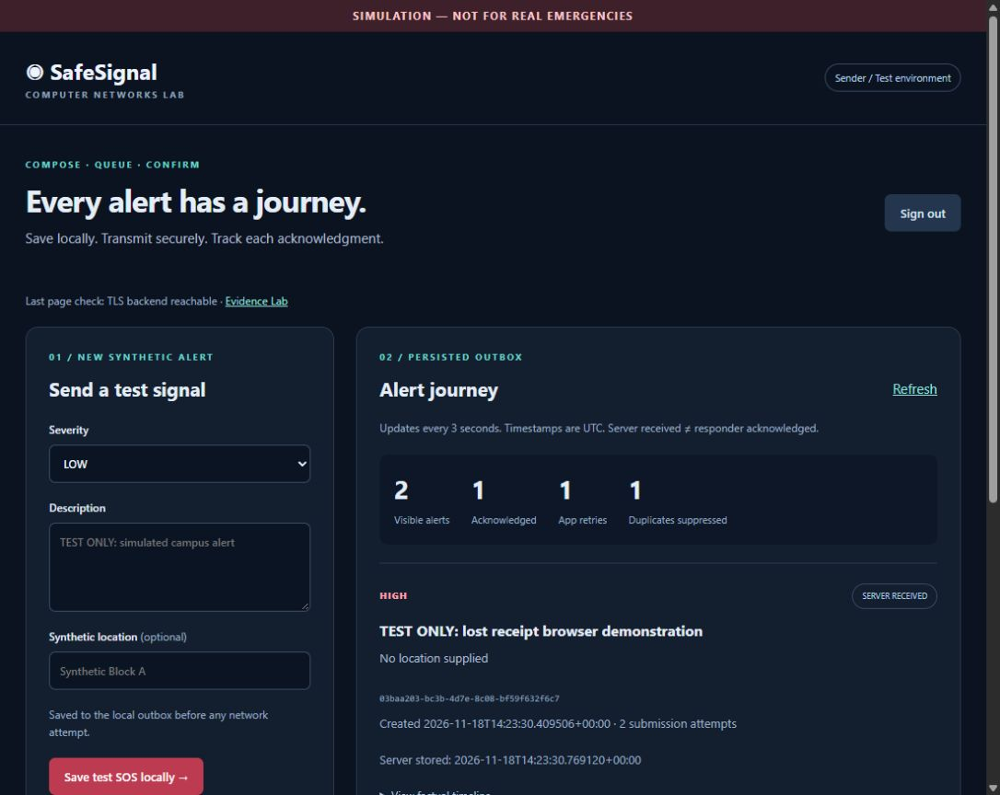
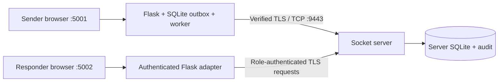
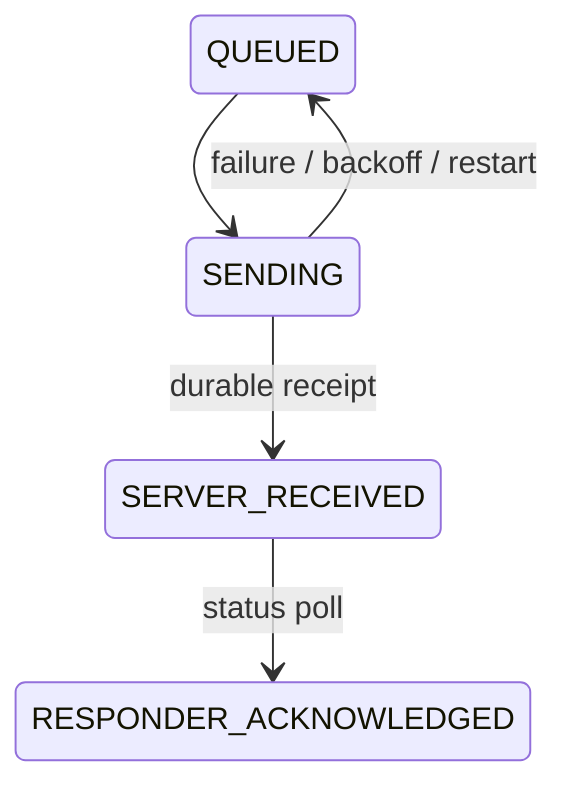

# SafeSignal

**SIMULATION — NOT FOR REAL EMERGENCIES**

A local Computer Networks lab prototype: persist a synthetic alert, send it over
verified TLS/TCP, retry the same UUID after failures, and track a separate
responder acknowledgment. No external APIs, emergency dispatch, GPS or cloud.



## Run locally

Python 3.11+ required (tested on Windows with Python 3.13.9). Run commands from
the repository root. Windows PowerShell:

```powershell
python -m venv .venv
.\.venv\Scripts\python -m pip install -r requirements.txt
.\.venv\Scripts\python scripts/init_demo.py
.\.venv\Scripts\python scripts/run_demo.py --enable-demo-faults
```

macOS/Linux (commands supplied; not executed on those hosts):

```sh
python3 -m venv .venv
.venv/bin/python -m pip install -r requirements.txt
.venv/bin/python scripts/init_demo.py
.venv/bin/python scripts/run_demo.py --enable-demo-faults
```

Open [sender](http://127.0.0.1:5001) and [responder](http://127.0.0.1:5002).
Use the corresponding sender_token / responder_token from generated,
ignored local/config.json. Never project or publish that file. The web page
does not contain backend tokens. Omit --enable-demo-faults to disable injection.
Ctrl+C stops the three processes; interrupted submissions recover on restart.

In this agent sandbox only, ensurepip/temporary paths can fail under the Unicode
workspace path. Workaround using host pip:
`python -m pip --python .venv/Scripts/python.exe install -r requirements.txt`.
Loopback tests require network access; do not disable TLS to bypass restrictions.

## Five-minute demo

1. Send a LOW **synthetic** alert. It is committed to the sender outbox before
   transmission; observe SERVER_RECEIVED after server commit.
2. Acknowledge in responder console. Sender polls to RESPONDER_ACKNOWLEDGED.
3. Set **Temporary sender disconnect**, submit, observe QUEUED. Reset Normal;
   worker retries the same UUID. Restart the demo to show disk persistence.
4. Set **First application receipt lost**, submit. Server commits, closes without
   receipt; retry produces one alert record and increments duplicate suppression.
5. Open Evidence Lab after running the experiment below. Explain sample size,
   chosen fault schedule and observation window. NS2 is a separate experiment.

[Full script, six-slide outline and viva](docs/demo-script.md).

## Tests and actual evidence

With the virtual-environment Python:

```sh
python -m pytest -q
python scripts/run_experiments.py --seed 7 --count 6 --window 2
```

The CLI uses its invoked Python; replace python with the environment executable
above if not activated. Each experiment starts its own real loopback TLS server,
isolated SQLite databases and seeded synthetic alerts. Results live in
artifacts/<run-id>/results.csv, summary.json, comparison.svg; latest run
appears in authenticated Evidence Lab with CSV/SVG downloads and PNG chart export.
No static success numbers are substituted for live state.

Recorded scenario: single attempt stored 4/6, retry stored 6/6; two duplicates
suppressed. Small, chosen app fault scenario, not a general performance claim.
[Raw reviewed results and methodology](docs/experiment-results.md).
[Independent NS2 instructions](ns2/README.md) · [Wireshark guide](docs/wireshark.md).
NS2 and Wireshark **not run on this host**. Parser fixture tests are synthetic.

## Architecture and state





4-byte big-endian length, max 16KiB UTF-8 JSON. One request/response per
connection; timeouts, field validation, bounded frames, role-scoped token rate
limits. SQLite PRIMARY KEY and immutable-payload hash handle retransmission and
ID conflicts. Server responds after transaction commit. Responder ACK is
idempotent. Priority ordering and five-alert pages keep wire messages bounded.
Backoff starts around 0.4–0.5s, caps at 30s, with jitter. One worker per outbox.

## Configuration, retention and limits

- All services bind 127.0.0.1; browser HTTP on loopback is a demo concession.
  TLS socket clients always verify server certificate and hostname. This is
  server-authenticated TLS plus tokens, not mutual TLS or end-to-end encryption.
- Certificate valid for 30 days. To renew while preserving tokens, stop the demo
  and run `python -c "from safesignal.tls import create_certificate; create_certificate('certs')"`.
  Init preserves existing config. Private keys, databases, captures and secrets
  are Git-ignored. Development keys are unencrypted on local disk.
- Optional SAFESIGNAL_SENDER_TOKEN, SAFESIGNAL_RESPONDER_TOKEN,
  SAFESIGNAL_SESSION_SECRET environment overrides. Generated local JSON is
  the default; .env.example documents settings, no automatic dotenv loader.
- Session login, CSRF, escaped HTML, local Host validation, login throttling;
  no production availability or security guarantee. Flask development servers
  are for this local lab only. No at-rest encryption or multi-tenant claims.
- Records persist until owner archives them. Stop all demo processes, then
  `python scripts/reset_demo.py`: moves demo databases into ignored
  local/archive-<UTC>/, preserving data; next start creates clean databases.
  Generated experiment runs are separate. No automatic destructive cleanup.
- A permanent outage cannot deliver. Recovery needs intact disk, running worker,
  reachable server. Server received means stored; responder acknowledged means
  explicit test acknowledgment. Neither means assistance dispatched.
- TCP retransmission differs from application retry. App fault presets do not
  emulate IP packet loss. No NS2/Python bridge is claimed.

## Git and publication

Published public repository: [mehakv194/safesignal-cn-lab](https://github.com/mehakv194/safesignal-cn-lab).

Real phase commits and verification notes: [findings](docs/findings.md). Feature
branches merge to main after checks. MIT license approved by project owner.
Original synopsis remains a local reference under ignored starter/ because it
contains enrollment numbers. The five source specifications are preserved in docs.

For a separate checkout without a remote, publish only after reviewing its content:

```sh
gh auth login --hostname github.com --git-protocol https --web
gh repo create safesignal-cn-lab --public --source=. --remote=origin --push
git push origin --all
```

This project's main and phase branches were actually pushed; no history was rewritten.
