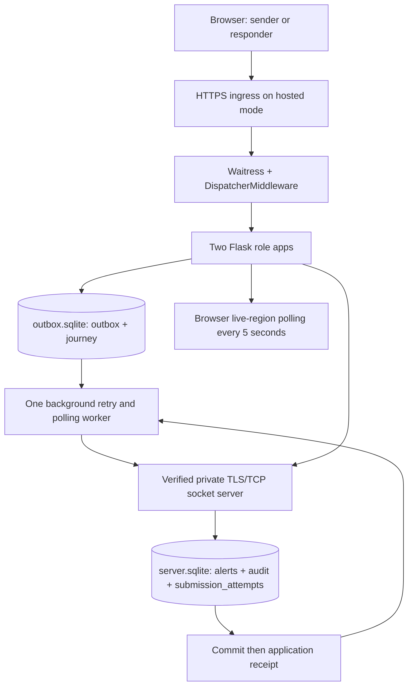

# SafeSignal v2 — Phase 0 baseline audit

Date: 19 November 2026 (Asia/Calcutta)
Branch: `codex/v2-phase-0-audit`
Baseline commit: `5a445017c2a7181d1ceb466a06be6caf09e15bc8`
Decision: **PASS for audit/baseline only. Phase 1 approval pending.**

## What this means for the user

The existing reporting and response app has a working regression baseline. Keep its networking engine and extend its identity and ownership boundary first. SafeWalk, private conversations and the security lab are not implemented yet. Nothing was deployed or changed in application functionality during this phase.

## Scope and instructions reviewed

Read the root CODEX_MASTER_PROMPT.md, all four new specification documents, the upgrade-pack README, current README and project workflow guide. Read all eight supplied skill manifests: baseline-guardian, identity-access, incident-room, mobile-experience, network-regressions, phase-gates, safewalk-engine and trust-lab. Baseline Guardian, Network Regression Keeper and Phase Gates govern this phase; the other skills inform the subsequent plan.

The uploaded package is a set of proposed requirements, not evidence of implementation or authorization to deploy. The user's instruction limits execution to Phase 0. No subordinate agents were used.

## Git safety and files

Initial branch: main. Tracked diff was empty. Existing untracked inputs were `.agents/`, `CODEX_MASTER_PROMPT.md`, `SafeSignal_Upgrade_Pack/`, the four new specification documents, and the earlier workflow document. They were preserved, not cleaned or automatically added to Git.

Before writing audit artifacts, created the isolated branch using `git switch -c codex/v2-phase-0-audit`. No push, production deployment, dependency installation or application refactor was performed. A branch alone is not a backup of untracked inputs: retain the original upgrade pack and include reviewed specifications in a later deliberate commit.

Added deliverables:

- `docs/implementation/BASELINE_AUDIT.md` — inventory, decisions, risks and preservation contract.
- `docs/implementation/IMPLEMENTATION_PLAN.md` — sequential phases, dependencies and gates.
- `docs/implementation/PHASE_STATUS.md` — actual gate report and approval state.
- `docs/implementation/evidence/baseline-desktop-1440.png` and `baseline-phone-390.png` — synthetic empty-state preview captures.

An ignored `local/phase0_audit_preview.py` harness and isolated `local/phase0-preview/` were created only to run the unchanged application on loopback port 5055 with synthetic credentials and new databases. They do not use the existing local databases. The preview was stopped after inspection.

## Actual architecture



`hosted.py` starts an ephemeral-port loopback socket listener and worker in one process; mounts `/sender` and `/responder`; root landing and `/healthz` are separate Flask routes. `scripts/run_app.py` uses the same runtime locally with HTTP browser access and verified private TLS. `runtime.py` retains the original separate-process lab. No need to rename or relocate these working modules.

Dependencies installed and pinned: Python 3.13.9 on Windows; Flask 3.1.3, cryptography 50.0.2, pytest 9.2.0, waitress 3.0.2. There is no Argon2id dependency or email subsystem in the current requirements.

### Existing features that must survive

| Area | Implementation and evidence |
|---|---|
| Report creation | Four categories, four severities, bounded description/location, UUID and UTC timestamp (`models.py`, `web.py`). |
| Durable-before-send queue | SQLite insertion before transmission; attempt counters, next eligible retry and crash recovery (`sender_store.py`). |
| Retry worker | Exponential backoff with jitter, capped at 30 seconds; approximately one-second loop; status synchronization until resolved (`sender_worker.py`). |
| Transport | Four-byte big-endian length, bounded 16 KiB UTF-8 JSON, fragmented read handling and timeouts (`protocol.py`, `server.py`). |
| TLS | Certificate verification enabled; wrong certificate rejected; server minimum TLS 1.2 (`tls.py`, transport tests). |
| Receipts and deduplication | Server transaction commits before response; UUID primary key and canonical SHA-256 payload hash; changed payload under same ID rejected (`server_store.py`). |
| Distinct states | Delivery QUEUED/SENDING/SERVER_RECEIVED/RESPONDER_ACKNOWLEDGED remains separate from REPORTED/ACKNOWLEDGED/IN_PROGRESS/RESOLVED. |
| Response actions | Team claim/acknowledgment, start, notes and resolution; transition validation and audit. |
| UI and discovery | Search, category/severity/progress filters, prioritized four-row responder pages, detail timeline and actual aggregate counts. |
| Live updates | Worker polls backend; browser refreshes live regions every five seconds, avoiding active/dirty form replacement. |
| Evidence | Recorded local results, CSV/JSON/SVG downloads, browser PNG chart export; no invented hosted benchmark. |
| Lab | Opt-in normal/delay/lost-receipt/disconnect faults and isolated experiments; NS2 parser fixtures and separate guides. |
| Existing security | Role checks, token comparison, CSRF, escaped templates, Host validation, hosted HTTPS, cookie flags, no-store, CSP, request bounds and throttles. |
| Operations | One-origin launcher, retained legacy launcher, health check and non-destructive reset/archive utility. |

### Current authorization boundary

`web.create_app` uses a shared token per role and Flask's signed client-side session, not an individually revocable server-side identity session. Login clears/rotates session content; logout clears the browser session. There is no account database, inbox verification, password/reset flow, explicit per-user expiration/revocation or enrollment validation.

Socket authorization is role-token based: submit is sender-only; list/update/dashboard are responder-only; status/audit accept either role. There is no owner principal or team-scoped resource authorization. `Store.submit` writes `sender_id='synthetic-sender'`. All sender sessions share the outbox. Analytics, timelines, lists, evidence exports and polling must all be considered when adding privacy; hiding navigation is insufficient.

Current login throttling is an in-memory per-app list (10 attempts/minute), not account/IP-aware; socket throttling is per shared role (100 requests/second). These are preserved baseline controls but insufficient as the new multi-user abuse policy.

## Database inventory and migration safety

Read existing local databases using SQLite URI `mode=ro`, inspecting table schemas and aggregate counts only. No incident bodies, credentials or private configuration values were exported.

| Database/table | Count | Meaning |
|---|---:|---|
| local/outbox.sqlite — outbox | 7 | Payload, delivery/retry metadata, copied lifecycle/assignment/last note. |
| local/outbox.sqlite — journey | 29 | Local delivery/progress events. |
| local/server.sqlite — alerts | 7 | Authoritative payload/hash, shared sender, receipt and response fields. |
| local/server.sqlite — audit | 14 | Server event/time/detail history. |
| local/server.sqlite — submission_attempts | 8 | NEW/DUPLICATE/ID_CONFLICT observations. |

Counts are a local snapshot, not an inventory of production data or archived files. Hosted configuration uses the same filenames under `/tmp/safesignal`; production databases were not opened.

Existing initialization uses CREATE TABLE IF NOT EXISTS, PRAGMA table_info and additive ALTER TABLE operations. Legacy acknowledged records are backfilled to acknowledged lifecycle with default desk/team. Outbox has similar additive lifecycle columns. There is no schema-version ledger, migration runner or tested full restore tool. SQLite connections use five-second timeout; WAL and foreign-key enforcement are not explicitly configured. Do not casually enable WAL or change transaction semantics without concurrency tests.

`reset_demo.py` archives databases after checking conventional local ports; it is not a backup of every possible alternate-port worker and is not a production backup utility. Do not run reset/migration against an active process. The isolated preview on 5055 was kept separate.

### Chosen storage direction for Phase 1

Use additive, versioned tables in the existing authoritative `server.sqlite` for users, hashed challenges, server-side sessions, responder permissions and security audit. Later phases place walks, check-ins, message and feedback records there too. Keep the existing outbox database as the transport queue/cache; add owner binding and scope its reads. This avoids introducing another product or splitting authoritative application records across additional databases.

Retain existing payload bytes and hashes on legacy records. Add nullable owner metadata separately; NULL means restricted legacy demo, never automatically claimable by a student. Future payload/context versioning must bind owner identity to a submission, and duplicate checks must include the immutable authorized owner binding without changing old canonical hashes. Test old migrations and new submissions separately.

Separate SQLite files cannot provide one transaction across the walk/link and outbox using the existing APIs. Plan a stable idempotency key plus a durable pending-enqueue intent in the authoritative transaction, reconciled to the outbox. Test crashes on both sides of the enqueue boundary; do not describe this as an atomic cross-database commit.

### Chosen internal identity boundary for Phase 1

Retain private TLS and protected service authentication, separate from human credentials. Add a versioned authenticated principal context bound to command, request ID and payload (for example a stdlib HMAC assertion using a dedicated server-only key). Flask derives the user/session from authenticated server state, never from a submitted owner/role field. Socket dispatch verifies the context, reloads current user/session/permissions, and enforces resource ownership/team policy at the store boundary.

Queued delivery uses an immutable, server-recorded owner-bound submission intent, not a short-lived browser session assertion stored for future replay. A worker authenticates its service request and resolves that intent; expired browser sessions must not strand already accepted reports or grant arbitrary reads. Reuse of request IDs for submit retries is not required: the report UUID and immutable owner/payload binding remain stable.

Privileged role tokens alone must not permit arbitrary v2 status/audit/list reads. Public legacy human token login goes away after migration. Preserve old networking tests as local compatibility coverage, but also test hosted mode denies legacy token-only bypasses. Legacy records are responder-only under explicit legacy-demo permission. A maintainer-only CLI provisions verified eligible responders; the default responder policy is explicit queue/team grants, not all records by default.

### Email decision

Use configurable legitimate email delivery, hashed expiring single-use challenges, Argon2id, revocable opaque sessions and generic recovery responses. Exact normalized email validation is `[0-9]{10}@mail\.jiit\.ac\.in` with full-match semantics; trim outer whitespace and lowercase domain only. Never use Unicode digit matching or treat eligibility as inbox proof.

No mail credentials/provider were inspected or selected. Tests/local development use captured delivery only. Hosted signup remains disabled unless real inbox delivery is configured and proved. Free mail availability and host egress compatibility require validation at the release stage; no paid provider is authorized. Missing live mail need not block local Phase 1 implementation, but blocks claiming live verified signup.

## Baseline verification

Actual command from repository root:

```powershell
.\.venv\Scripts\python.exe -m pytest -q --basetemp=C:/Users/mehak/.codex/visualizations/2026/11/18/01a1eef0-be7d-75d1-b1ed-8f0bbffef830/v2-phase0-baseline
```

Result: **28 passed in 27.41s**, exit 0. No failures or skips reported. Network-enabled execution was used for isolated loopback fixtures; test temporary databases were separate from user data. This is a fresh Windows baseline, not a new Linux CI run.

Coverage inspected: transport authentication, malformed/oversize/fragmented frames, wrong certificate, UUID duplicate/conflict, commit-before-lost-receipt recovery, abrupt process exit, backoff, outbox recovery/polling, terminal monotonicity, full incident lifecycle, bounded Unicode notes/audit, legacy schema preservation, web role/CSRF/escaping/Host checks, login throttle, disabled faults, honest backend outage display, combined runtime restart, actual Waitress forwarded-scheme handling, free-host configuration, archive preservation, real isolated experiment export and synthetic NS2 parsing.

Tests do not prove per-user privacy because that capability does not yet exist. No live authenticated production flow, external mail, real mobile keyboard, NS2 execution, Wireshark capture or new load benchmark was performed.

## UI baseline and discrepancies

Captured unchanged app with synthetic empty databases on 5055 after shared sender login:

- [Desktop 1440×900](evidence/baseline-desktop-1440.png)
- [Phone 390×844](evidence/baseline-phone-390.png)

Phone capture shows adapted stacked cards but an icon-only left rail, analytics before journeys and very small labels. CSS sets buttons to minimum 38px and many inputs/text styles below 16px; v2's 44px/16px targets are not met as a general rule. Existing viewport metadata, focus styles and reduced-motion-aware transitions are useful to retain. Full seven-width accessibility/keyboard compliance is not claimed from these two captures.

Discrepancies/caveats relative to guide and target:

1. v1 workflow guide broadly matches source; none of the v2 account/walk/chat/Trust Lab features exists yet.
2. Current claims of persistent queue mean surviving intact SQLite, not guaranteed cloud retention. There is no client offline outbox.
3. Current sessions are signed browser cookies, not individually revocable identity sessions.
4. Current timelines return latest eight server events; UI chart export is source-inspected, not separately clicked in this audit.
5. Hosted code disables faults by default/configuration, but `ENABLE_DEMO_FAULTS=1` can enable them in hosted runtime. v2 local-only lab controls need an explicit public-mode denial invariant rather than merely a hidden button.
6. Recorded prior deployment success is documentation, not a fresh production health/security check in Phase 0.
7. Target says retain terminal lifecycle while permitting student disagreement. Use independent feedback/review state and an explicit follow-up workflow; do not silently regress RESOLVED or rewrite history.

## Risks and decisions before feature work

| Priority | Risk | Required mitigation |
|---|---|---|
| Critical | Shared identity leaks future private records if retained as authorization. | Owner/team guards in every route, poll, aggregate/export and socket operation; negative tests. |
| High | Migration assigns old reports to new people or changes dedup hashes. | NULL legacy owner, restricted legacy view, byte/hash preservation fixtures. |
| High | Worker identity expires or can forge arbitrary ownership. | Service-authenticated durable submission intents, owner binding, permission reload and tamper/replay tests. |
| High | Walk committed but help not queued, or duplicate help after crash. | Transactional intent and idempotent enqueue reconciliation. |
| High | Render sleep/reset defeats continuous check-ins and retention. | Persistent-row reconciliation when rows survive; explicit simulation warnings, no monitoring guarantee. |
| High | Verification bypass when free email is unavailable. | Disabled hosted signup; mocked delivery only in local/tests. |
| High | Public lab/fault controls accidentally enabled. | Local-only server gate plus direct request denial tests in public mode. |
| Medium | Shared in-memory throttle causes cross-user lockout or resets. | Account/IP-aware bounded policy with trusted proxy handling and security events. |
| Medium | Small text, hidden navigation and keyboard overlap. | Mobile-first Phase 2–4 checks at all seven widths. |
| Medium | New payloads exceed 16 KiB or unbounded lists grow costly. | Bounded/paginated messages, ownership indexes and wire-size regression cases. |

## Backup, rollback and release controls

No migration ran. Existing databases and secrets remain untouched. Before Phase 1 migration: stop all writers, make a consistent SQLite backup of both files into ignored local backup storage, record schema versions/counts and private integrity checks, and verify restoration into a separate test directory. Do not publish copied databases, email identifiers or secrets. Keep original v1 commit and input pack.

Use additive versioned migrations in a transaction with migration fixtures and restoration checks. Code rollback alone does not guarantee database compatibility. Restore backup to an isolated path, verify with baseline tests, then switch only after explicit operational approval. Public fallback must disable signup/access safely; never reactivate shared public human-token login to recover from v2 auth problems.

No production data migration, Git push, host configuration changes or paid services are authorized by this phase. Deployment needs separate explicit approval even after all development phases pass.
